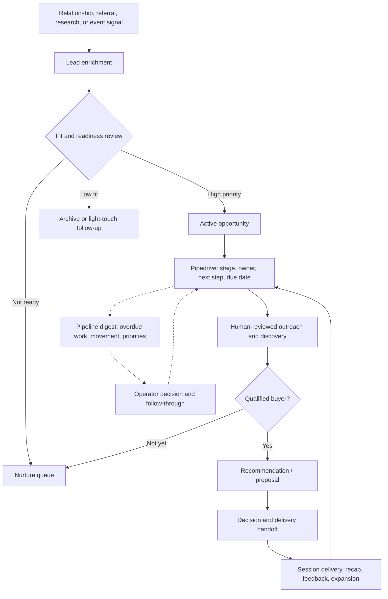

# Designing a CRM-centered growth and delivery operating system

**A client-anonymous system-design case study: connecting research, qualification, outreach, events, CRM follow-through, and service delivery.**

| | |
|---|---|
| **Client** | Founder-led athletic leadership and training organization (not named publicly) |
| **Engagement** | Product and operations design, CRM workflow architecture, campaign execution support, and AI-assisted process improvement |
| **My role** | Discovery, business rules, system design, project leadership, AI-assisted research and communications, CRM/automation implementation direction, review, and operational execution |
| **Core platform** | Pipedrive CRM; outreach and reporting workflows; reusable operating playbooks |
| **Evidence** | March–April 2026 pipeline, qualification, enrichment, planning, outreach, event-conversion, and delivery artifacts; prior technical review of private automation work |
| **Sharing boundary** | No client records, identifiable prospect lists, outreach correspondence, financial forecasts, client documents, or private implementation |

## The business problem

The client had relationships, program offerings, events, and potential institutional buyers, but the work was scattered across conversations, documents, email, and CRM records. A list of contacts did not answer the questions necessary to run the business: **Who is worth pursuing? Who owns the next step? What should happen before a proposal? Which deals are stalled? How does interest turn into a delivered engagement and a longer-term relationship?**

The assignment was not just to configure Pipedrive or write outbound emails. It was to define a repeatable **lead-to-delivery system**, including the commercial rules, information model, handoffs, controls, and operating rhythm.

## My work and the system boundaries

My work spanned several connected workstreams:

1. **Process discovery and prioritization:** Turn a loosely defined growth objective into a staged 90-day plan with separate CRM, offers, lead activation, sales, event, and delivery work.
2. **CRM and data model:** Use Pipedrive as the canonical system for pipeline stage, owner, next action, due date, lead source, qualification tier, and opportunity value.
3. **Research and qualification:** Define what evidence is needed before outreach, who counts as a decision maker, how to score fit, and when to nurture rather than pursue.
4. **Communications and event execution:** Develop segment-specific outreach materials, an event registration/conversion experience, follow-up sequences, and operating responsibilities.
5. **Follow-up and delivery design:** Define stage transitions, response-time expectations, handoffs into service delivery, post-session feedback, and expansion opportunity tracking.
6. **Operator visibility:** Specify recurring priority digests that surface stale records, overdue activity, proposals, next decisions, and top actions.

The implementation and writing work was AI-assisted. My contribution was translating business needs into clear workflows, data and approval constraints, executable workstreams, review standards, and coordinated delivery. I do not claim to have manually written every automation or all outreach copy.

## System architecture: the lead-to-delivery loop



**Architecture note:** This diagram is an anonymized model of the operating design described in project documents—not a diagram of every deployed integration. Solid arrows describe workflow and human decisions; dotted arrows represent the reporting and feedback loop. The CRM remains the source of truth rather than allowing automated messages or a secondary board to become conflicting records.

## 1. CRM as the operational source of truth

The pipeline design defined eight stages:

**Lead → Contacted → Discovery Scheduled → Discovery Completed → Proposal Sent → Negotiation → Closed Won / Closed Lost**

Each stage had explicit entry/exit rules. Records required an owner, next step, and follow-up date; loss reasons were captured on closed opportunities. The operating specification also addressed stage aging, proposal follow-up, stale leads, and weekly management reporting.

Examples of rules defined in the March 2026 documents:

| Decision point | Specified rule or action |
|---|---|
| Newly identified lead | Verify contact, assign owner, log initial action, schedule next step |
| Before active outreach | Complete basic enrichment and identify a reachable buyer or advocate |
| Discovery completed | Document qualification, recommended offer, and accountable next step |
| Qualified opportunity | Target prompt proposal preparation and follow-up |
| Stale opportunity | Review, re-engage, re-qualify, or close with a reason |
| Engagement delivered | Capture recap, buyer feedback, and expansion signals in CRM |

This is **workflow architecture**, not merely a dashboard design: records have required states, ownership invariants, transition criteria, timing expectations, and recovery paths.

## 2. Enrichment and qualification before automation

The documented lead-enrichment process covers organizational context, decision-maker identification, audience/program characteristics, need, timing, likely offer fit, and a useful outreach angle.

A four-part qualification rubric evaluated **budget, authority, need, and timeline** and routed leads into a small set of priority tiers:

- **Act now:** Strong fit and a credible decision path.
- **Nurture:** Relevant prospect, but timing, budget, or access still needs work.
- **Low priority:** Weak current fit or little actionable buying signal.

Importantly, the case did **not** call for a black-box AI lead score. Qualification had explainable business criteria and a human-owned decision. This was a deliberate design choice for trust, correction, and operational adoption.

## 3. Event registration as a second acquisition path

The source documents include an event-specific landing-page brief, segment research, a prioritized outreach sheet, customized messages, and follow-up sequences.

The planned customer journey connected:

```text
Event invite / referral
  → registration or team inquiry
  → attendee / buyer intent captured
  → qualified, owned CRM record
  → same-day or next-day follow-up
  → discovery call or nurture
  → tailored offer
  → delivery and expansion opportunity
```

The landing-page brief specified separate actions for **individual attendance** and **bringing the program to a team**, so conversion did not depend entirely on selling event tickets. The event conversion plan segmented high-, medium-, and low-intent responses, with distinct follow-up ownership and deadlines.

The uploaded archive contains real campaign preparation and follow-up materials. It does not independently establish attendance, resulting bookings, closed sales, or that every proposed page or automation was launched.

## 4. AI-assisted research and communications with human review

AI helped accelerate the information-heavy parts of the work: account research and synthesis, outreach-angle development, message variants, follow-up sequences, campaign materials, and operating documentation.

The **boundary was intentional**: AI-generated or template-based copy was supporting material for an operator to review, not authority to send unverified communications automatically. The previously documented private outreach workflow prepared Gmail **drafts** and CRM notes, rather than autonomously emailing prospects.

This distinction matters in client-facing AI systems: accuracy, relationship context, consent, and human accountability are part of the product design.

## 5. Pipeline visibility, service handoff, and recovery

The recurring management digest was specified to include:

- Pipeline value, weighted value, and open proposals.
- Overdue follow-ups and opportunities with no forward movement.
- Newly added leads and discovery calls requiring preparation.
- Deal-stage changes and near-term delivery work.
- **Three concrete next priorities**, each with an owner and due date.

The uploaded **digest design documents specify WhatsApp for short operational visibility and email for a fuller weekly record**. They do not establish a deployed Slack integration.

The delivery playbook linked sales to the next workflow: buyer alignment, session preparation, service delivery, same-day notes, follow-up, testimonial/feedback requests, and potential repeat engagements. CRM updates and ownership rules prevented delivery from becoming an information dead end.

## Implementation evidence and what remains unverified

It is important to distinguish **design and authored operating materials** from tested technical integrations and measurable business outcomes.

| Component | Evidence / status |
|---|---|
| Pipeline stages, required fields, owners, SLAs, qualification tiers | Detailed operating specifications in the supplied project archive |
| Enrichment SOP, discovery process, offer ladder, delivery handoffs | Written working playbooks and structured templates in the archive |
| Event outreach and registration/conversion path | Audience research, prioritized account sheet, page brief, message sets, and follow-up reports |
| AI-assisted research, message drafting, project planning | Prepared working artifacts, including variants and campaign follow-ups |
| Pipedrive-related automations (lead intake, follow-up, stale-item detection, draft preparation) | Documented as built and validated in the prior technical portfolio review; **the newly uploaded archive does not contain execution logs or source code to independently reverify that status** |
| Recurring digest delivery over WhatsApp / email | Designed and documented; ongoing production operation not established by this archive |
| Slack notifications or Slack-to-CRM integration | **Not verified** in the supplied documents; should not be represented as shipped |
| Revenue lift, win-rate improvements, event bookings | No validated outcome measurements supplied; none claimed |

### Selected deliverables represented by the private project files

- CRM pipeline and stage-exit definitions.
- Lead enrichment and qualification playbooks.
- Recurring priority digest specification.
- 90-day operating and commercialization plan.
- Discovery call, proposal, and offer-structure templates.
- Event landing-page and conversion briefs.
- Segmented lead research and multi-step outbound follow-up materials.
- Delivery operations and post-engagement follow-through playbook.

**Confidentiality:** The underlying documents include identified prospects, direct contact information, commercial assumptions, and internal campaign messaging. They are deliberately **not** published in this portfolio. The case study communicates the system design while leaving all client-specific records and working assets private.

## Design decisions and trade-offs

| Decision | Benefit | Cost or constraint |
|---|---|---|
| Keep Pipedrive canonical | Avoid inconsistent lead and opportunity states | Every workflow must reconcile back to a CRM record |
| Require owner, next step, and due date | Make the pipeline action-oriented | Adds discipline and data-quality checks |
| Score with explainable business criteria | Clear and auditable prioritization | Requires human assessment and periodic review |
| Start from personalized outreach rather than bulk sending | Protect relationship quality and accuracy | Less raw automation throughput |
| Separate the event funnel from institutional sales | Accommodate both ticket buyers and larger team buyers | More routing and follow-up paths |
| Make reporting end in three priorities | Turn data into decisions | Needs careful summarization instead of sending everything |
| Connect delivery back to the CRM | Make follow-up, proof, and expansion visible | Requires a consistent closeout routine |

## Outcome and relevance

The work produced a coherent operating blueprint and a substantial set of usable sales, CRM, event, and delivery materials, alongside previously documented CRM automation work. The archive supports the design and preparation work; it does **not** prove a conversion-rate improvement or a specific dollar impact.

For technical product and fractional leadership roles, the important demonstration is **systems thinking**: translating an ambiguous business objective into a canonical data model, stage transitions, rules, dependencies, integrations, human decisions, and operational feedback loops.

---

*Case-study material is intentionally anonymized. The client relationship, prospect data, unpublished communications, private repository, and detailed commercial plan are not disclosed.*
