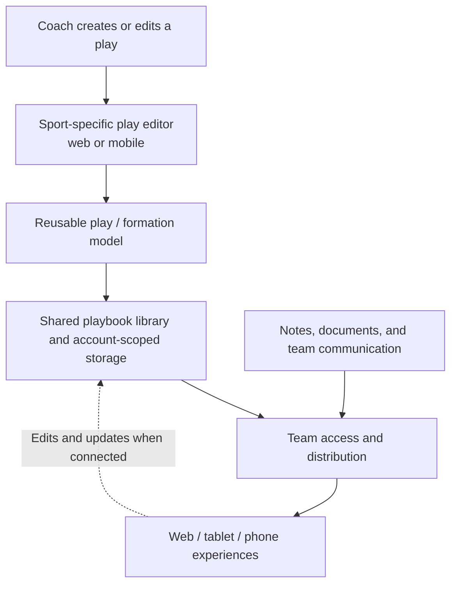

# Cross-platform coaching and playbook platform — product and engineering leadership

**Turning coaches' diagrams, tactics, and team communication into a shared digital workspace used on web and mobile devices.**

| | |
|---|---|
| **Organization** | Early-stage sports-software venture (name intentionally omitted) |
| **Period** | 2014–2018 |
| **My role** | Director-level software engineering and business-development leadership; product and project management |
| **Product** | Multi-sport digital playbook creation, animation, storage, sharing, team content, and communication |
| **Platforms** | Desktop/web and iPad, iPhone, and Android experiences |
| **Business experience** | Early-stage business development, team leadership, roadmap/delivery management, and exposure to a seed-funding process |

## Problem: a team's playbook was trapped in disconnected materials

Coaches needed to create plays, teach formations, distribute changes to players, and have the right information available when preparing for—or actively managing—a game. Traditional whiteboards and paper binders were difficult to update and share consistently across an entire team.

We developed a cross-platform product around a shared playbook: **draw and diagram a play, save and organize it, share it with the team, and return to the material from the relevant device**.

## What we built

The product family supported football, basketball, and soccer coaching workflows. Capabilities included:

- **Play authoring:** Diagram positions, routes, and tactics, with sport-appropriate field/court views and play animation.
- **Playbook management:** Organize, store, and return to saved plays and collections.
- **Team distribution:** Share plays and playbooks with coaches and players rather than sending disconnected images each time something changed.
- **Team workspace:** Supporting team communication and a place for related documents and notes.
- **Multiple use environments:** Web/desktop use for planning, plus mobile/tablet access—including sideline scenarios on iPad, iPhone, and Android.

Historical public product listings corroborate the core play drawing, animation, saving, team sharing, and mobile/web experience. Other workflow details, including the breadth of multi-sport support and team documentation, are included based on my firsthand involvement. The product is historical; this portfolio is **not** claiming a currently maintained or fully supported service.

## High-level product architecture

**Diagram scope:** This is a **conceptual product/data flow**, not a reverse-engineered deployment diagram. It does not assert particular cloud providers, databases, programming languages, message transports, or offline-conflict algorithms that cannot be verified from the available historical evidence.

## Engineering challenges and decisions

### One product model across devices

The same play could be created during planning on a larger screen and used later by a coach on the sideline. That made shared play representation and consistent library behavior more important than optimizing any single device in isolation.

### State and synchronization

Saving an individual diagram is easier than keeping **team-accessible playbooks** coherent across mobile and web. The product required decisions about remote storage, membership/access, and how edits appear when someone returns on another device. Historical release notes refer to improvements in playbook synchronization; this case does not imply synchronization was perfectly reliable in every release.

### Design for the real environment

A sideline user has different needs than someone diagramming on a desktop. Fast access, clear play visualization, touch interaction, and recoverable saved work were product priorities. I am not claiming guaranteed offline support or particular network failure-handling behavior absent verified implementation.

### Combine delivery with customer development

The roadmap had to balance sports-specific feature requests, coaching feedback, account/team functions, cross-platform release coordination, and the commercial realities of an early-stage business.

## Leadership, project management, and business development

In a director-level role spanning **software engineering and business development**, I helped connect product direction, engineering execution, team coordination, partner/customer development, and delivery planning. That included keeping a cross-platform engineering roadmap practical while translating coaching needs into features the team could ship.

The company also **raised seed funding** during its early-stage journey. My involvement gave me firsthand familiarity with preparing and operating in a fundraising-stage company, although I am **not claiming to have been the sole fundraiser, secured a specific amount, or led investor negotiations** without further supporting evidence.

This combination matters for fractional CTO and early-stage technical product roles: a founder needs someone who can understand customers and market constraints, coordinate engineers, help make build-versus-business trade-offs, and operate effectively as priorities change.

## Trade-offs

| Decision | Why | Constraint |
|---|---|---|
| Provide web and mobile experiences | Coaches plan in different places than they use the playbook | Coordinating cross-platform changes and support |
| Store plays as reusable team assets | Preserve work and make tactical materials shareable | Access, synchronization, and state management |
| Support multiple sports | Extend the core diagramming concept to different coaching needs | Sport-specific layouts and features increase complexity |
| Pair creation tools with notes and team communication | Keep knowledge close to the plays people need | Workspace scope can grow beyond core drawing |
| Iterate with users while managing the business | Align releases with real coaching behavior and fundraising-stage constraints | Requires balancing delivery, customer feedback, and commercial development |

## Outcome and status

The work produced a **real historical product**, not just a concept deck: mobile editions and web playbook functionality were publicly released. This case study intentionally avoids unsupported claims about revenue, active users, funding amount, or today's product availability.

**Attribution and privacy:** Original business/product names, employee names, customer data, internal documentation, proprietary implementation details, and source code are omitted by choice. The summary distinguishes publicly corroborated product functionality from additional firsthand career experience. The architecture diagram is educational and deliberately generic.
