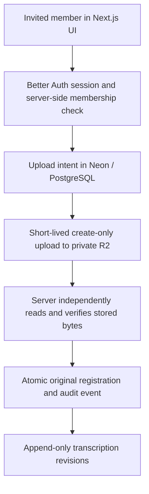
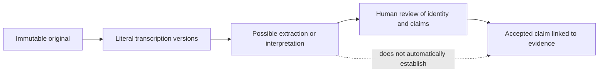

# Garifuna Family Initiative

**Building a trustworthy digital archive for preserving family and cultural history.**

**Status:** Invitation-only application in development. Milestone 4C completed hosted validation with synthetic material in isolated Neon and private R2 resources. Production provisioning and first-family intake remain Milestone 4D work. The private application source and family records are not published here.

## The problem

Family photographs, documents, and stories are scattered across people and generations. A useful archive must preserve each original, explain its context, and protect sensitive information. A name found in a record may be a transcription; a proposed relationship is an interpretation; neither is automatically a verified family fact.

## My contribution

I set the product vision and domain rules, made the architecture and privacy decisions, directed AI-assisted engineering work, reviewed implementation, and validated the critical workflows. The implementation was substantially AI-assisted; I do not claim to have handwritten every line.

## Implemented archive path

The application uses Next.js and TypeScript, Neon/PostgreSQL with Drizzle, Better Auth, and private Cloudflare R2 object storage. Membership is invitation-only and enforced server-side. The browser computes a SHA-256 checksum and uploads an original directly to R2 with a short-lived, create-only signed request. The server reads the stored object independently, checking its size, signature, MIME type, and checksum before registering it. A database checksum constraint and transactional finalization protect against duplicate originals, including concurrent submissions.

Registered originals are write-once. Image transcriptions create numbered revisions; previous versions and audit events remain available. PDFs retain the original and audit trail, without a transcription editor in this milestone. Protected downloads require membership. These are application and database controls; administrator-level retention and production recovery remain separate operational work.

### Sanitized architecture

This diagram describes the implemented archive path at a high level. It contains no private schema, storage keys, or infrastructure identifiers.

### Evidence and review boundary

The first two stages are implemented for supported image sources. Extraction, identity resolution, claim review, and public genealogy presentation are domain and data-model plans; they are not exposed in the current UI. The diagram shows the intended distinction, not a released end-to-end genealogy workflow.

## Decisions and tradeoffs

| Decision | Reason | Cost or limit |
|---|---|---|
| Preserve original bytes and identifying fields | An accepted source should not silently change | A better scan becomes a new source |
| Use direct, create-only private uploads with independent server verification | Large files bypass ordinary request bodies while the server verifies what was stored | Multi-step upload and cleanup logic |
| Reject duplicate SHA-256 originals | Prevent accidental duplicate registration | An identical file cannot become a separate original in this milestone |
| Append transcription and audit history | Corrections remain traceable | More storage and explicit version handling |
| Keep evidence, interpretation, and verified claims distinct | A matching name or model output cannot establish genealogy | Human review is required before a claim is accepted |
| Restrict access to invited members | Family privacy is a system requirement | No public self-service archive |

## Validation and current limits

The private source documents accepted Milestone 4C validation of real R2 upload and protected retrieval, hosted owner sign-in, browser CORS, rejection paths, signed-out access denial, and Neon integrity and concurrency checks. The test material was synthetic. Production database and object storage provisioning, backup and restore rehearsal, and first-family experience are deferred to Milestone 4D. This is evidence of a validated private workflow, not a claim that the archive has launched publicly or begun real family intake.

No real family record, identity, private screenshot, internal URL, or storage path is included in this case study. The diagrams are sanitized explanatory reconstructions from the private architecture and domain documentation.
