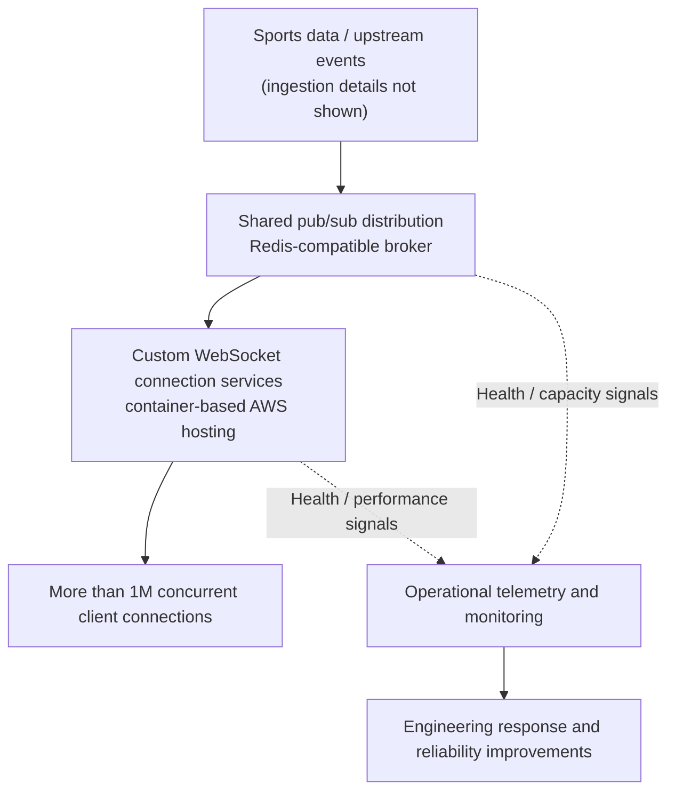
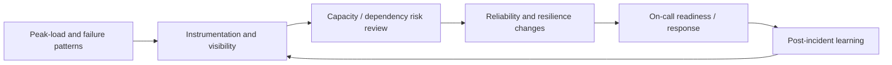

# Premier sports-media platform — real-time delivery and reliability engineering

**Scaling live data distribution for a high-traffic sports experience while moving from reactive incident response toward observable, resilient operations.**

| | |
|---|---|
| **Organization** | A premier national sports-media organization (client/employer name intentionally omitted) |
| **Period** | 2020–2023 |
| **My role** | Senior engineering manager; approximately 20 engineers across three teams |
| **Work represented** | Real-time fan-facing data distribution, platform architecture leadership, system reliability, incident readiness, and operational improvements |
| **Scale** | More than **1 million concurrent device connections**, based on firsthand project experience |
| **Evidence** | Career experience and a conceptual, non-proprietary architecture—not source code or internal diagrams |

## The problem: live traffic exposes reliability weaknesses

A sports platform has sharp, event-driven demand peaks. Fans expect timely changes as games unfold, while applications and operations teams need confidence that the underlying services remain available.

When I joined, observability was inconsistent across products. Peak traffic could surface **CPU saturation, disk-space pressure, and resource exhaustion on legacy EC2 workloads**. Too often, engineers discovered the issue when something was already degraded and then had to respond during weekends or major events.

This was both a technical and organizational problem: availability depended too heavily on manual intervention, service health was difficult to see consistently, and external-provider or infrastructure failures had the potential to interrupt dependent work.

## Real-time data distribution

The system delivered updates to large numbers of connected devices using **persistent WebSocket connections** and **topic-based pub/sub**, so clients could subscribe to the games and data they actually needed.

**Evidence and boundaries:** The confirmed high-level architecture involved custom WebSocket services running on **Amazon ECS** with **Redis / ElastiCache** as a shared pub/sub broker. Clients connected to the custom WebSocket services. Upstream ingestion, load-balancer type, exact failover topology, databases, capacity figures beyond the stated concurrency, and internal software names are intentionally not described. The diagram is **illustrative**, not an internal production schematic.

### Architectural choices and trade-offs

| Decision | Why it mattered | Trade-off |
|---|---|---|
| Maintain persistent WebSocket connections | Low-latency, ongoing updates rather than repeated polling | Connection lifecycles, reconnection, and large fan-out demand disciplined capacity management |
| Group updates by topics | Avoid transmitting irrelevant data to every client | Subscription design and broker behavior become critical concerns |
| Use shared pub/sub between event distribution and connection services | Allow many server instances to consume relevant updates | Broker capacity and failure behavior require ongoing attention |
| Operate container-hosted custom connection services | Control protocol and behavior for a specialized workload | More engineering/operational responsibility than a fully managed push service |
| Treat observability and reliability as architecture work | Reduce dependence on discovering failures through customer impact | Instrumentation, alert tuning, and ownership require continuous upkeep |

These are decisions and operating concerns at a public-safe level, not a claim that I personally wrote all infrastructure components.

## A second workstream: shifting reliability from reactive to designed-in

Real-time distribution was only one part of my engineering leadership. A parallel focus was making the broader product suite easier to operate during high-traffic periods and more tolerant of failures.

### Before

- Operational signals were fragmented or absent across parts of the product suite.
- CPU, storage, or instance saturation could become a production issue before a team had clear advance warning.
- Weekend and event-time incident response too often meant engineers diagnosing and repairing issues manually.
- Downstream applications could be exposed to upstream vendor or infrastructure failures.

### Improvements we drove

1. **Observability:** Expand service-health visibility and operational monitoring across products so engineers could diagnose trends, errors, and saturation instead of relying solely on after-the-fact incidents.
2. **Reliability:** Raise the expectation for availability and test/operate systems around busy-event behavior, not average traffic alone.
3. **Resilience:** Reduce the chance that an individual upstream vendor or hardware failure would interrupt all dependent operations; design around isolation and continuity where appropriate.
4. **Recoverability:** Make failure identification, response, and restoration part of routine system design and engineering practice.
5. **Operational readiness:** Improve ownership, alert usefulness, incident preparedness, capacity awareness, and the ability of teams to manage production systems.

**Terminology note:** These five areas are a descriptive framework for this case study. I am **not claiming** they were the exact formal names of an internal “five Rs” methodology.

The work aimed to move operations away from the recurring pattern of “an engineer has to fix something every big weekend” and toward clearer signals, better prevention, and systems designed to continue through partial failures. **Specific circuit breakers, failover products, or redundancy patterns are not claimed here without verified implementation evidence.**

### Uptime impact — recalled, not audited

My recollection is that availability moved from **roughly 99.8% toward 99.9%** during the reliability effort. This is an **approximate recollection**, not a published SLA, independently verified measurement, or a controlled before/after comparison. The verified point for this case study is the operational focus and the improvement work, not a precision availability claim.

The practical outcome was stronger observability, improved failure tolerance, and a more deliberate approach to handling traffic peaks. I am not reporting quantified incident reductions or on-call savings that I cannot substantiate.

## Leadership and execution

As a senior manager across **three engineering teams and approximately 20 engineers**, I was responsible for translating business and product demands into engineering priorities; aligning system architecture and operational standards; reviewing technical trade-offs; and helping teams deliver and operate complex software.

The work combined architecture judgment with staff development, engineering planning, cross-team coordination, and operational accountability—not just one isolated service.

## What this demonstrates for fractional technical leadership

A growing business usually needs both a plan for its next features and an answer to “What happens when the service, vendor, or infrastructure fails?” This engagement illustrates my ability to oversee engineers, reason about architectural scaling, improve system reliability, and make operations a first-class product concern.

**Disclosure:** Employer and internal platform names are intentionally omitted. No employer-owned code, screenshots, architecture documents, incident records, credentials, private system endpoints, or proprietary incident metrics are included. The diagrams are abstractions of firsthand experience.
