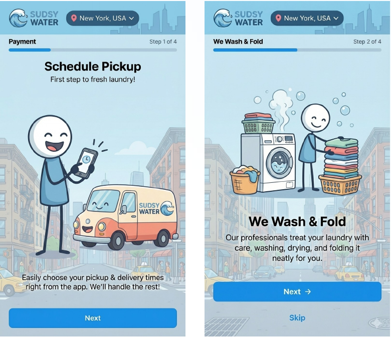
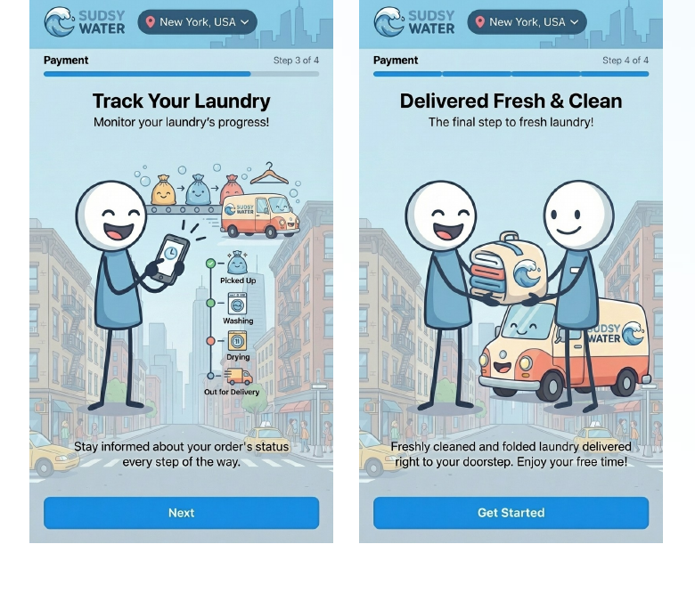
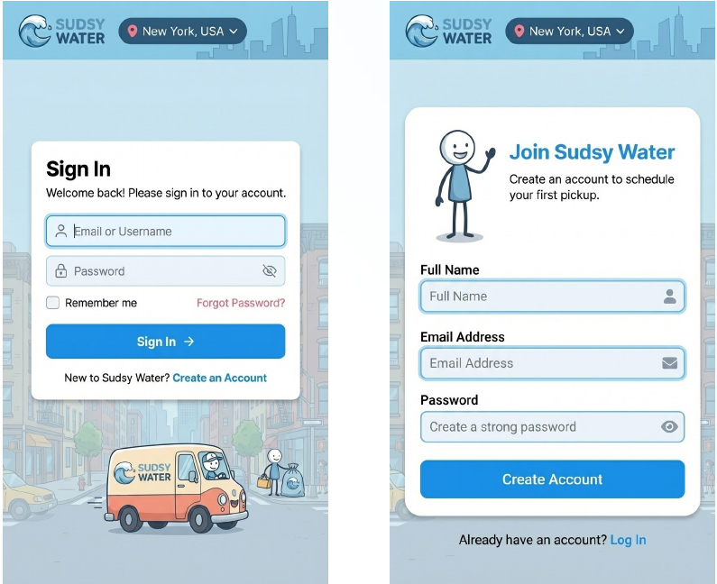
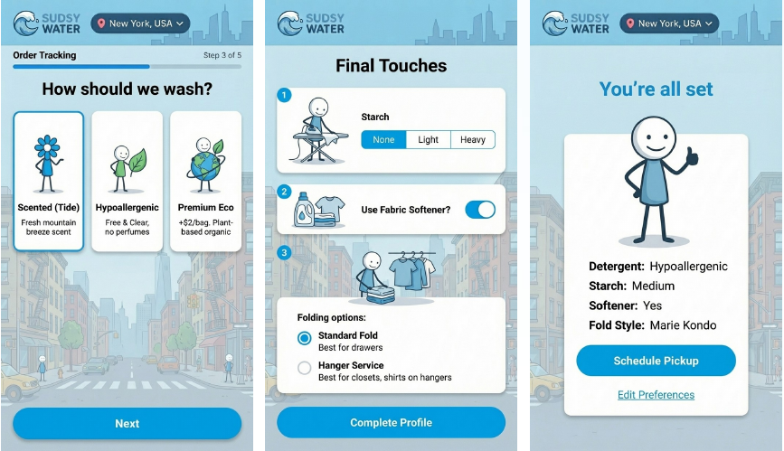
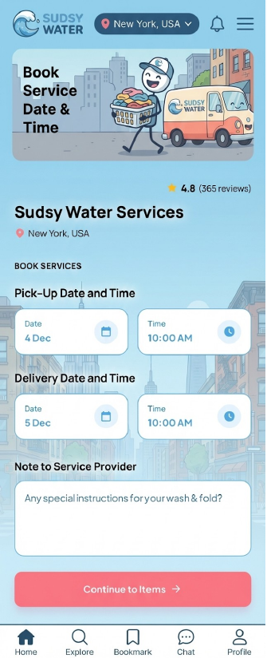
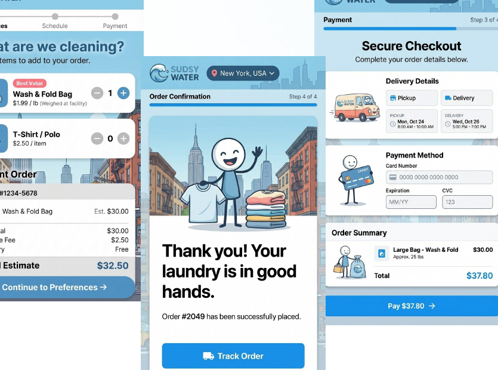
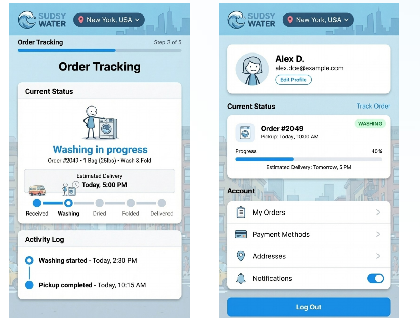

# Premium NYC Laundry Service — Product and Mobile UX Concept

**Designing a reliable pickup-and-delivery experience for a premium neighborhood laundromat.**

**Status:** Discovery, proposed service model, and mobile application design concepts. **Not launched.**  
**Location context:** New York City, particularly high-service residential buildings.  
**My contribution:** Opportunity assessment, product strategy, user flows, mobile UX concept design, scope definition, positioning, and implementation/operational trade-off analysis.

> **Confidentiality:** The business is deliberately unnamed in the editorial case study. Some original concept screen designs retain the working brand used in the presentation; that is intentional. The screenshots are design concepts, **not evidence of a launched product or live payments, driver tracking, or integrations.**

## Problem: a service experience with a trust gap

For busy residents, pickup-and-delivery laundry creates a coordination problem as much as a cleaning problem. The proposed market had two common alternatives: traditional providers with limited digital convenience and app-led intermediaries that could make the actual cleaning and handoff feel less accountable.

Our product thesis was that the mobile app should not merely take orders. It should make the complete physical service understandable and easy to trust: **the same accountable team, predictable building handoff, saved garment preferences, and visible progress.**

## The customer and service model

The pitch explored three audience segments:

| Audience | Need surfaced by the concept |
|---|---|
| Busy residents and professionals | Schedule a routine pickup quickly without coordinating every detail |
| Building concierges and property staff | Predictable, low-disruption handoffs and recognizable service providers |
| Higher-volume institutional clients | Consistency, predictable scheduling, and dependable capacity |

The proposed service model paired a directly accountable laundry operation with a premium digital layer, rather than positioning the app as a marketplace of unknown gig workers. This was a **proposed operating model**, not a claim about how an active service operated.

## UI and product decisions

The supplied 23-slide product pitch contains actual mobile screen concepts I designed for the following experience. The seven screenshots below have been cropped directly from the original concept slides without altering their internal UI or working branding. **Evidence:** all seven PNGs are original concept-screen extracts, preserved at their source dimensions. They are designs from the pitch, not screenshots of a launched application.

| Concept screen | Original deck slide | Design intent |
|---|---:|---|
| Onboarding introduction | 8 | Explain the service before asking for information |
| Concierge-friendly handoff | 9 | Normalize building pickup and return expectations |
| Account creation | 10 | Keep profile setup short and remember the building |
| Garment preferences | 11 | Save detergent, starch, softener, and fold choices once |
| Pickup scheduling | 12 | Prioritize a fast default booking, with optional changes |
| Service selection and checkout | 13 | Clarify wash-and-fold versus dry cleaning and show cost before confirmation |
| Order tracking | 14 | Make progress and chain-of-custody cues visible |

The visual work uses light, spacious layouts and a consistent blue interface language, with a contrasting action color for next-step controls. The purpose was to make an everyday chore feel reassuring rather than complicated.

**Evidence classification:** Design-screen concepts from the original pitch deck, not screenshots of production software. They should not be conflated with the separate, locally running exploratory prototype previously shown in this portfolio.

### Original concept screens (image upload outstanding)

**Onboarding and customer expectations — deck slide 8**

**Concierge handoff — deck slide 9**

**Sign-in and account creation — deck slide 10**

**Saved garment-care preferences — deck slide 11**

**Pickup scheduling — deck slide 12**

**Service selection and checkout — deck slide 13**

**Order status and handoff tracking — deck slide 14**

These images are **design artifacts** from a proposal. Content, quoted ratings, service availability, transaction confirmation and tracking states shown in them are **illustrative**, not verified live operations.

## MVP scope and sequencing

Rather than build every feature up front, we divided the proposed experience into an initial core and trust-building follow-ups:

- **P0:** Fast pickup booking, service selection, and secure checkout as proposed functionality.
- **P1:** Order tracking and saved garment profiles, as higher-trust differentiators.

This prioritization balanced getting to an understandable transaction with recognizing that trust ultimately depends on reliable real-world fulfillment. A simple mobile UI does not by itself establish delivery capability, garment accountability, or building cooperation.

## Service design, acquisition, and operating constraints

The deck connected product design to operations and customer acquisition:

- **Building relationships:** Treat concierge processes and property-manager relationships as part of the service experience.
- **Focused launch geography:** Design routes and outreach around a coherent cluster of high-service residential buildings instead of citywide coverage.
- **Word-of-mouth and local awareness:** Explore referrals and geographically focused outreach where adjacent households could share a dependable experience.
- **Risks to validate:** Concierge participation, driver handoff scans, service consistency, and return-use after an initial order.

The original pitch also modeled a pilot operating target, a multi-phase growth roadmap, and illustrative demand projections. Those were **planning assumptions**, not achieved results. Exact client-specific assumptions and locations are omitted from this public summary.

## Outcome

The discovery effort produced a market and service hypothesis, audience definitions, mobile journey designs, MVP priorities, launch dependencies, and concrete questions about the cost and difficulty of operations.

The app and proposed business were **not launched** in this phase. The meaningful outcome was making the customer experience and operational commitments clear enough to support a decision not to pursue the build at that time.

## Design artifacts and sharing status

A 10-slide **sanitized portfolio excerpt** has been prepared from the original deck. It includes the actual concept screens while removing client-identifying editorial headings, named pilot locations, internal growth targets, and launch planning detail. Some screen designs still display the working brand, as explicitly permitted for screenshots.

**Portfolio review:** seven authentic concept screen extracts are published on this page. A shorter, client-anonymized presentation excerpt has been prepared for separate review; the original private 23-slide pitch deck has not been published here.

This case study prioritizes the original UI design screens and the product decisions they illustrate. A separate exploratory coded prototype is not presented as launch evidence.

---

**Authorship note:** I led the concept and design work represented in the pitch, with AI assistance in the broader exploration. This case study does not claim a live service, independently validated market traction, or manually authored production source code.
