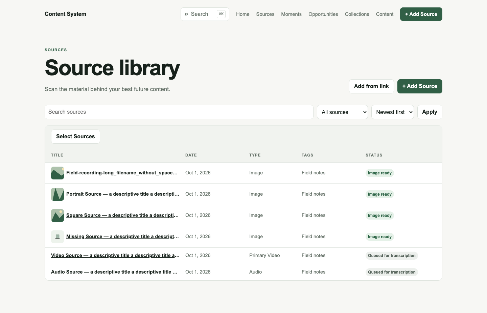
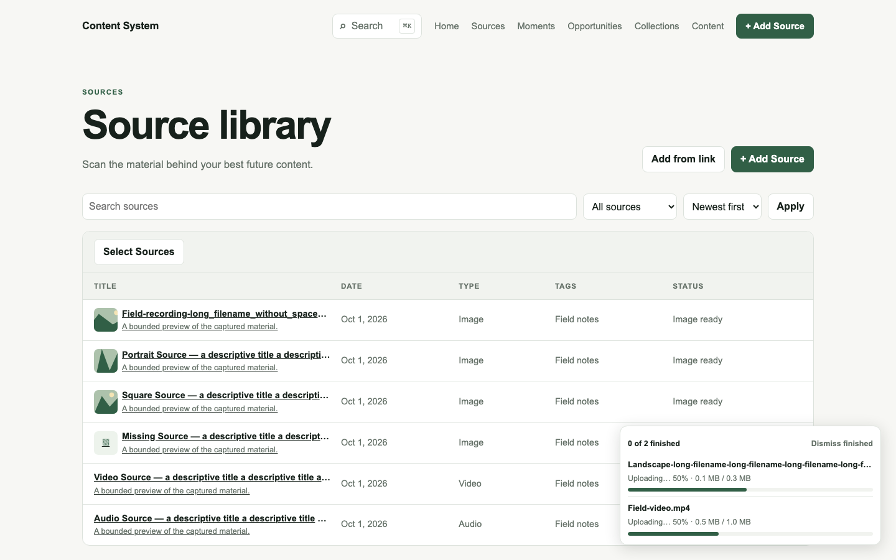
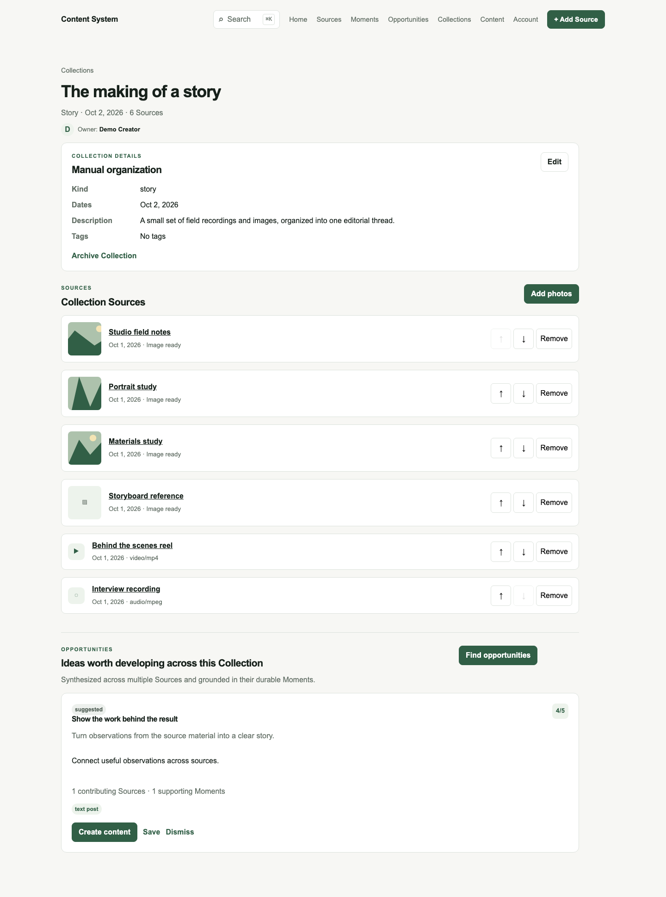
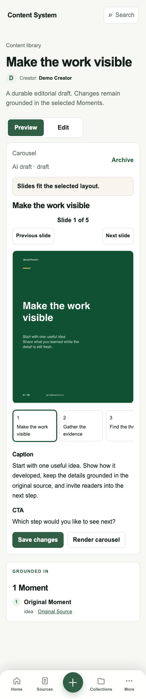
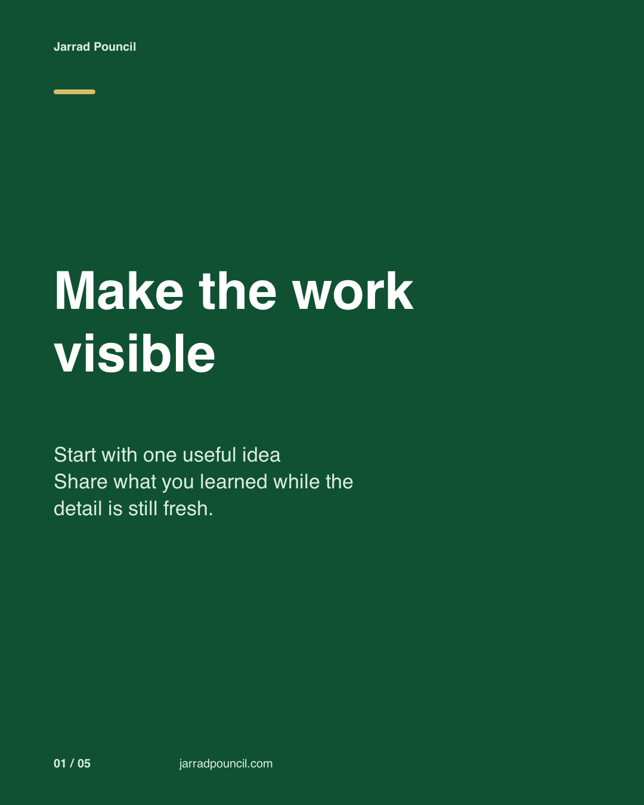

# Roomfor Studio

**From raw source material to grounded, editable content — without losing where an idea came from.**

[Live product](https://cs.jarradpouncil.com) · Authenticated access is limited · [Jarrad Pouncil](https://jarradpouncil.com)

> **Portfolio note:** Roomfor Studio is the public brand used for this case study. The working product currently displays the earlier name “Content System” in its header. The screenshots below are unaltered captures of the implemented UI, using synthetic test fixtures rather than real user content.

## At a glance

| | |
|---|---|
| Product | A private, source-grounded content workspace |
| Status | Working application in active development; sign-in is invitation-limited |
| My role | Product direction, UX decisions, system architecture, coding-agent direction, implementation review, and validation |
| Platforms | Responsive web application, including mobile workflows |
| Evidence | Real implemented UI captured by the product's browser regression suite |

## The problem

Creating useful content from long recordings, scattered images, links, and notes is not mainly a writing problem. It is a retrieval and trust problem.

Source material is difficult to scan. Strong observations get separated from their evidence. AI can produce a draft quickly, but a draft is less useful when the creator cannot see what it came from, revise it safely, or turn it into a ready-to-use asset.

Roomfor Studio was designed around a different question:

**How can a creator move from raw material to an editable output while keeping the reasoning and source trail intact?**

## My contribution

I owned the product from workflow definition through validation:

- set the product direction and sequenced the source → understanding → moment → opportunity → content loop;
- made the responsive UX decisions for libraries, workspaces, progress states, editing, preview, and export;
- defined the domain and system boundaries for private media, durable processing, structured AI output, and provenance;
- wrote constraints and acceptance criteria for coding agents, reviewed their output, and redirected implementation when the product behavior did not match the intent;
- validated releases through code review, automated tests, responsive browser checks, and production-path verification.

The implementation was substantially AI-assisted. My contribution is accurately described as product ownership plus architecture, agent direction, review, and hands-on validation—not as personally handwriting every line.

## The product loop

1. **Ingest** video, audio, images, pasted text, or a supported video link.
2. **Organize** sources in a searchable library and ordered collections.
3. **Understand** the material through transcription and structured analysis.
4. **Preserve evidence** by keeping useful moments and generated opportunities linked to their sources.
5. **Compose** editable content in formats such as carousels, text posts, short-video plans, newsletters, and presentations.
6. **Preview and export** carousel slides as rendered images and presentations as editable files where supported.

## Implemented UI evidence

### 1. A scan-first source library



The library is designed for retrieval, not storage alone. Search, type, tags, dates, and processing status let users understand both what an item is and what the system is doing with it.

### 2. Upload progress that stays in context



Large media is uploaded directly to private object storage through short-lived capabilities. The UI keeps multi-file progress visible without blocking the rest of the workspace, while server-side checks independently verify the completed upload.

### 3. Collections as working context



Collections are more than folders: users can order related sources, see the collection's scope, generate cross-source opportunities, and continue into content creation without discarding provenance.

### 4. Mobile carousel review



The mobile experience prioritizes the rendered result. A user can inspect each slide, see fit feedback, move between slides, and return to editing before export.

### 5. A real rendered output



Carousel export is not a mockup-only path. The application renders 1080 × 1350 PNG slides, checks layout fit before export, and packages the set for download.

## Decisions and tradeoffs

| Decision | Why | Tradeoff |
|---|---|---|
| Keep generated ideas linked to exact source moments | Trust and revision matter more than producing the fastest generic draft | Requires a richer data model and more deliberate UI |
| Upload media directly to private object storage, then verify it independently | Avoids routing large files through ordinary web requests while preserving integrity checks | Adds a multi-step upload lifecycle and recovery states |
| Model processing as durable jobs | Transcription and analysis can outlive a browser session and fail in recoverable ways | More operational complexity than a synchronous request |
| Store AI output as typed, editable content items | Users can review, revise, validate, and export a durable draft | Structured formats require schemas and format-specific editors |
| Validate carousel fit before export | The preview and downloaded result should agree | Long copy must be shortened or revised instead of silently overflowing |
| Use a focused five-item mobile navigation with contextual actions | Keeps the primary workflow reachable on small screens | Secondary destinations move behind a “More” action |

## Sanitized architecture

```text
Responsive web UI
    ↓
Authenticated product services
    ├── relational product data
    ├── private media storage
    ├── durable background processing
    └── provider boundaries for transcription and AI analysis
            ↓
Versioned, source-linked outputs
    ↓
Editable content items → preview → export
```

The application uses a modern TypeScript/React web stack, a relational database accessed through an ORM, private object storage, and isolated provider adapters for transcription and AI generation. Credentials and provider details remain server-side. This public case study intentionally omits source code, schemas, internal URLs, operational identifiers, and deployment configuration.

## Security and privacy choices

- Owner-scoped reads and writes are enforced at service boundaries.
- Original media remains private and is accessed through bounded capabilities.
- Uploads are checked for size, signature, and checksum before registration.
- Long-running work uses explicit states, retry rules, and recovery paths.
- The screenshots in this repository contain synthetic fixtures only.
- This repository was created independently; it contains no history from the private product repository.

## Current status and limitations

- The core source workflow, private upload, transcription, structured analysis, source library, moments, opportunities, collections, editable content items, carousel preview/rendering, and supported export paths are implemented.
- The public URL exposes the product shell and sign-in experience; workspace access is intentionally limited.
- The in-product name has not yet been changed from the working title “Content System” to Roomfor Studio.
- The product is still evolving, so this is evidence of a working system rather than a claim of broad public availability or measured customer-scale outcomes.
- Validation on the reviewed revision passed type checking and linting. The full automated run passed 302 of 303 tests initially; the single timed-out FFmpeg thumbnail test passed immediately when rerun in isolation.

## What I would measure next

- time from first source added to first useful exported draft;
- percentage of generated opportunities saved, dismissed, or turned into content;
- edit depth between AI draft and export;
- processing failure and recovery rates by workflow stage;
- repeat use of collections and cross-source generation.

---

**Need a direct application link?** Use this page:

`https://github.com/jpouncil2/product-case-studies/tree/main/projects/roomfor-studio`
