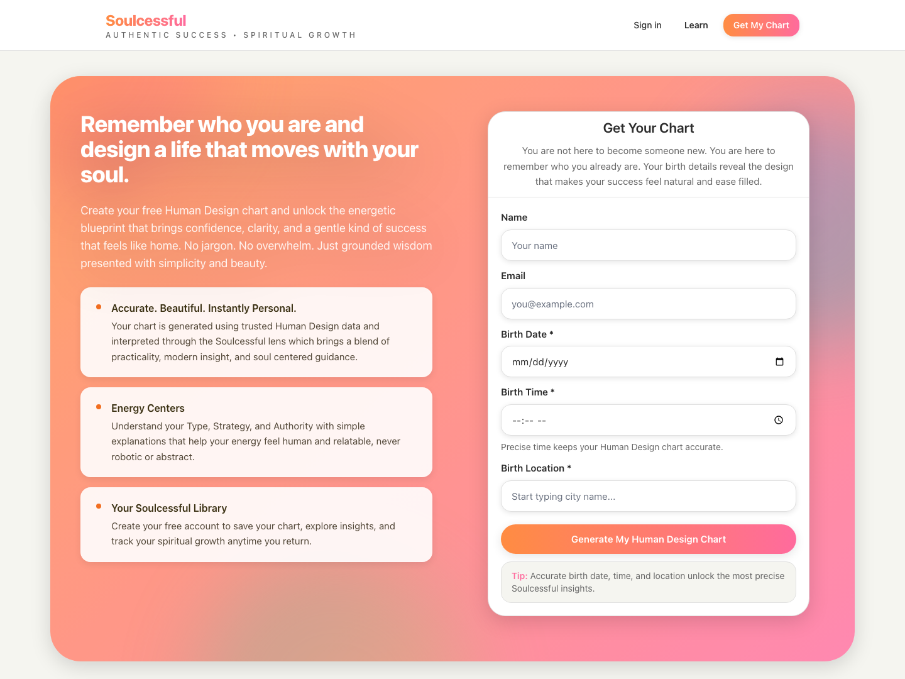
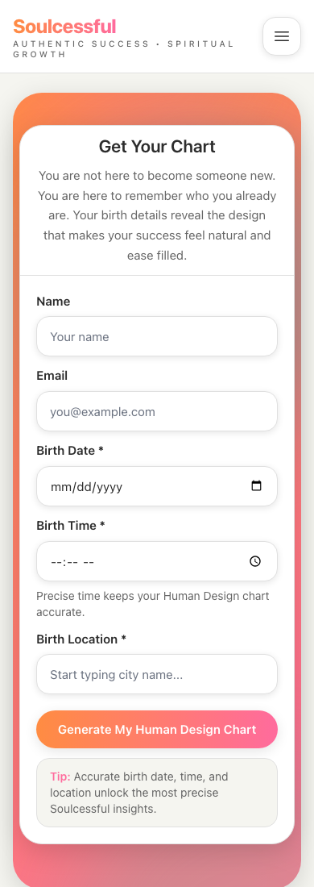

# Soulcessful — making a personal-insight journey approachable

**A website product and UX case study, with real desktop and mobile evidence from the public experience.**

[Visit Soulcessful](https://soulcessful.co) · **Status:** live public chart-entry page; a separate private app repository remains an early scaffold.

## The experience question

Soulcessful begins with an idea that can feel abstract to a first-time visitor: personal clarity through Human Design. The public entry page has to explain the value in plain language, ask for birth information without overwhelming the visitor, and make the first action obvious.

I designed and directed the public website experience: its product framing, page structure, visual and copy hierarchy, responsive behavior, and chart-entry journey. The work was AI-assisted and collaborative in implementation; directing the site does not mean I hand-coded every component. These screenshots document the live interface, not a claim that every feature described on the page is implemented.

## Real UI evidence

### Desktop: explain the value beside the action

At desktop width, the page pairs the promise and three short benefit explanations with the primary form. The visitor can understand *why* the information is requested while seeing exactly how to begin.

### Mobile: bring the task forward

On a narrow screen, the form becomes the first task. The fields stay in a single vertical sequence and the primary action remains visually distinct. The capture uses **blank fields**; no person's birth details or account information are included.

Both screenshots are unaltered captures of the public page on October 19, 2026. They show the **entry UI**, not a generated chart, authenticated library, or evidence of what happens after submission.

## Product and UX decisions

| Decision | User benefit | Open question |
|---|---|---|
| Use plain-language copy before specialist terminology | A newcomer can understand the value without prior Human Design knowledge | Test whether the promise matches what users receive |
| Show the form next to the value story on desktop | Reduces the gap between explanation and action | Measure where people abandon the form |
| Make the form the first mobile task | Keeps a long page from hiding the conversion path | Confirm that supporting context remains easy to find |
| Ask for precise birth data with short helper text | Explains why specificity matters | Validate privacy, consent, and storage practices separately |

## Scope and limits

The private app repository contains product and front-end specifications, shared types, a minimal web skeleton, and API stubs. It is **not** proof of a completed personal library, production chat, or insight engine. This case study keeps the live public page distinct from those plans and does not assert chart-generation accuracy or conversion outcomes.

The site was designed and directed by Jarrad Pouncil with AI-assisted implementation. The screenshots evidence its current public UI, while the separate app scaffold remains early-stage work.
