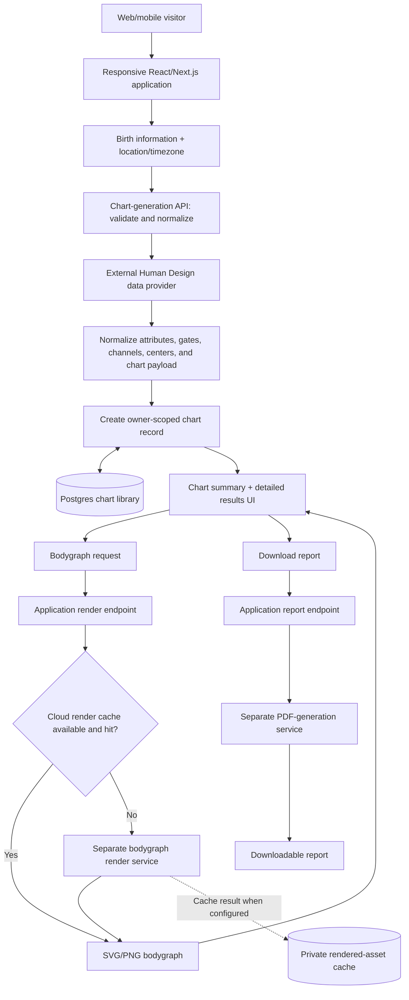

# Soulcessful — Human Design Product and Systems Architecture

**From birth-data intake to a persistent, revisit-able chart, a rendered bodygraph, and downloadable reports.**

[Public product](https://soulcessful.co) · **Evidence:** live desktop/mobile entry UI and implemented private application code · **Status:** public web entry experience; chart-processing and saved-chart systems implemented in the private application, with production behavior not independently retested for this portfolio review.

## The product problem

Human Design involves structured birth inputs and complex calculated data. A useful consumer experience needs more than a form or attractive chart: it has to validate precise inputs, reliably obtain chart attributes from an external provider, preserve the resulting record, render a usable diagram, and let someone return to their history without starting over.

The product architecture separates **chart computation/data**, **application storage and ownership**, **visual rendering**, and **downloadable report generation**. Keeping these concerns distinct made it possible to iterate on the UI and visual output without changing the core data source.

## My contribution

I led product direction and user-journey design while guiding the technical architecture and AI-assisted implementation. My responsibilities included defining what users should experience, choosing service boundaries, structuring persisted chart data, directing implementation agents, reviewing API/UX behavior, and validating that generated results could be saved and retrieved. The development process was AI-assisted; I am not claiming to have handwritten every component.

The portfolio contains two separate private engineering efforts that should not be conflated:

- **The working Human Design web app:** Next.js, server API routes, Clerk integration, Postgres/Drizzle persistence, external Human Design provider adapter, chart-library APIs, bodygraph render integration, and report generation.
- **A separate later Soulcessful app scaffold:** product requirements, architecture planning, shared types and placeholder endpoints. Its scaffold status does **not** describe the maturity of the chart-generation application above.

## End-to-end system architecture

**Architecture reading guide:** The external Human Design provider returns chart data; it is **not the same thing** as the separate service that renders the visual bodygraph. The database stores the reusable chart record. The rendered bodygraph and PDF are derived outputs. Cloud render caching is conditional on deployment configuration and is not claimed to be active in every environment.

### 1. Input and chart-data integration

The user enters a birth date, time, and location. The server accepts the inputs through a chart-generation route and uses schema validation to normalize dates, location coordinates, and timezone values.

A server-side provider adapter calls the Human Design API and translates the upstream response into application-oriented fields such as **type, strategy, authority, profile, centers, gates, channels, and planetary activations**. The adapter includes timeout/retry handling and limited caching. A local demo-data fallback exists for environments without a configured provider; this is not presented as evidence of a production API response.

**Design decision:** Keep vendor-specific response mapping on the server, so the UI can consume a consistent representation without coupling display components directly to a provider's raw schema.

### 2. Persistence and the chart library

The chart-generation flow attempts to persist the processed result immediately. The app stores chart metadata and structured chart data in **Postgres**, accessed through **Drizzle ORM**. The record includes an owner identifier, birth-input metadata, a chart-data JSON document, timestamps, and optional interpretation/provider details.

This data model supports returning to an existing chart instead of calling the external data service for every library visit. Chart-generation responses also communicate whether persistence succeeded rather than silently implying that the chart was saved when storage is unavailable.

**Key operations in the private implementation:**

| Workflow | Implemented behavior |
|---|---|
| **Generate** | Validate birth data, request chart attributes, normalize results, attempt to persist a new chart |
| **Save and list** | Store chart data and retrieve a paginated, owner-scoped library |
| **Open again** | Fetch saved chart details by identifier and return a view-ready summary |
| **Update** | API supports metadata changes and can regenerate chart data when inputs change; some library editing UI remains gated |
| **Delete** | Remove an owned chart through its API route, with deletion initiated from the library UI |
| **Sign in later** | Use Clerk for account identity and migrate eligible anonymous charts to that account |

The database is the durable record; the rendered bodygraph and downloaded report are separate presentation outputs.

### 3. Identity, ownership, and returning users

The system supports an initial chart experience without requiring a user to create an account first. It uses an anonymous identity and signed cookie for the initial session, then recognizes Clerk-authenticated ownership if a person signs in. Migration logic connects eligible anonymous chart records to the authenticated account, helping preserve previously created work.

Chart library detail and mutation routes scope access to an owner. This is an important product choice: **guest conversion and data ownership must work together**. Asking everyone to register before seeing value would add friction; leaving saved records completely detached from identity would make the experience unreliable.

The private repository has implementation and QA artifacts for anonymous-to-account migration. This portfolio review did not conduct new authenticated end-to-end production testing.

### 4. Visual bodygraph rendering

A structured Human Design data response is useful for textual insights, but users also expect the familiar visual chart. The client requests the bodygraph through an application route that calls a **separate rendering service** to produce SVG/PNG output.

The application implements a cache-aware render path: look up a rendered asset by chart/payload and rendering version; on a miss, request the visual from the renderer; when configured, store the resulting asset and metadata in private cloud storage for later requests. The implementation includes revision-aware cache keys and invalidation handling.

**Trade-off:** Splitting data generation from visual rendering adds one more service boundary, but allows the visual layout, export format, and render performance to evolve independently of calculation/persistence.

### 5. Downloadable chart reports

A second service boundary supports report downloads. The Next.js application has a report endpoint that validates the request payload and proxies it to a dedicated PDF/report-generation service. The frontend can reuse existing chart data to request a formatted report rather than treating PDF creation as another chart calculation.

This is a **separate report workflow** from the SVG/PNG bodygraph rendering route. The underlying UI and code show the integration path; the portfolio does not assert which premium/report options were publicly available at every moment.

## Real UI evidence

### Desktop: clear value proposition beside the input flow

The desktop composition explains the value without requiring specialized knowledge and places the first action beside that explanation.

### Mobile: make the initial chart task straightforward

The responsive layout puts the entry form first, with a vertical flow for birth date, time, and location. These are unaltered captures from the public site using empty fields, not a chart belonging to a real user.

**Next visual evidence to add:** synthetic screenshots of the generated chart, interactive bodygraph, saved-chart library and delete/return flow. They are intentionally **not** fabricated or represented as currently attached to this case study.

## Product and technical decisions

| Decision | Reason | Trade-off |
|---|---|---|
| Normalize the external provider response server-side | Keep UI stable when the provider schema or formatting varies | Adapter and validation logic need maintenance |
| Persist chart data independently of its visual rendering | Allow saved charts, revisits, alternate presentations, and report reuse | Requires a durable data model and explicit ownership |
| Permit anonymous generation before authentication | Lower the barrier to first value | Requires signed identity handling and careful account migration |
| Separate bodygraph rendering and PDF generation | Keep specialized rendering/report workloads independent | More service boundaries and failure cases |
| Cache rendered assets with version-aware keys | Reduce redundant visual rendering on repeat views | Cache invalidation, storage, and privacy require design attention |
| Scope chart reads and deletion to an owner | Protect private personal input and saved results | Access must be enforced across all chart lifecycle routes |

## Boundaries, status, and evidence

- **Confirmed in private application code:** generation endpoint, external provider adapter, owner-scoped chart CRUD, Drizzle/Postgres chart schema, Clerk/anonymous identity integration, bodygraph render proxy, and PDF service proxy.
- **Supported by implementation and historical QA documentation:** saved-chart APIs, database migration, responsive chart UI, and anonymous-chart migration; the chart cache also has implementation code.
- **Shown directly in this public case study:** real entry-page screenshots on desktop and mobile.
- **Not independently reverified in the current review:** latest production configuration, third-party uptime, end-to-end live persistence, report rendering, or actual user adoption.
- **Not claimed:** publicly accessible source code, conversion/revenue results, universal chart-generation accuracy, or availability of all planned premium features.

The original repositories remain private. This portfolio entry presents only high-level technical boundaries and product decisions—no environment variables, provider credentials, raw user birth data, internal deployment information, or client content.

---

**Takeaway:** This project demonstrates end-to-end product and software-system thinking: an approachable consumer interface backed by input validation, external data integration, persistence and ownership, a chart-rendering service, and repeat-use functionality.
