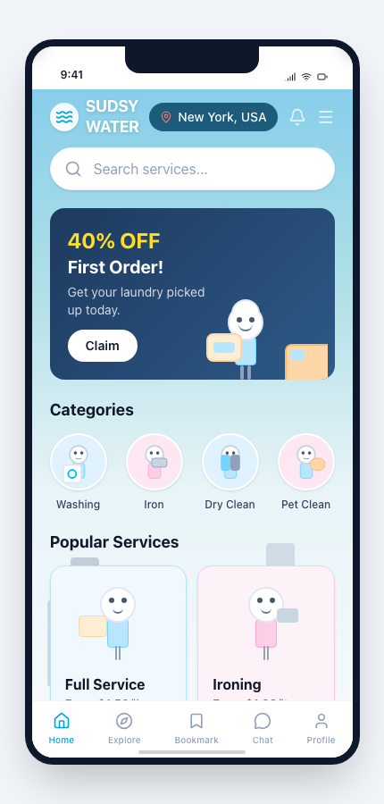
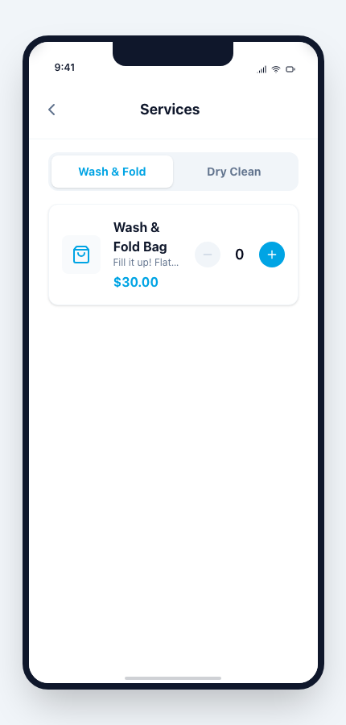

# Sudsy Water — deciding what *not* to build

**A laundry-service concept tested through strategy, workflow design, and an interactive mobile prototype.**

**Status:** concept and prototype; the proposed app-based business was **not launched**. The resulting decision was not to pursue this direction at that time.

## The question

A founder operating several businesses was considering a laundry and wash-and-fold service with an app-based customer experience. The product question was not simply “Can we design an app?” It was whether the opportunity justified the time, capital, and operational attention needed to make pickup and delivery work.

My work combined the opportunity framing, market and competitive review, experience concepts, and a prototype that made the proposed service tangible enough to evaluate. This was an exploration, not evidence of a launched service or customer adoption.

## What the prototype made concrete

The proposed loop was **discover a service → choose items → review an order → arrange handoff → follow progress**. The handoff was especially important: a polished booking flow would not solve the service problem if customers still had to wait at home for pickup.

The repository contains a React-based mobile prototype with authentication/onboarding, dashboard, booking, and account routes. Its checkout and order behavior are simulated; prices, promotions, payment details, and service availability are illustrative, not live offers.

### Implemented prototype UI

The dashboard explores a friendly service entry point and a clear route into booking. The promotional copy is sample content in the prototype.

The booking screen tests a short path from service choice to cart. These are unaltered captures of the locally running prototype, not production screenshots.

## Decisions and tradeoffs

| Choice | Why it mattered | Limit |
|---|---|---|
| Prototype the service journey before building operations | Made the customer promise concrete enough to critique | A clickable flow cannot validate real pickup logistics |
| Explore building/doorman handoff | Addressed the physical coordination burden behind the app idea | Required operational validation outside the UI |
| Treat checkout as a simulation | Kept the exploration fast and inexpensive | No real payment, booking, or fulfillment integration |
| Preserve a clear “no” as an outcome | Protected focus for higher-priority work | No launch or conversion metric to claim |

## Outcome and lesson

The strategy sprint produced a market view, an app concept, an operating path, and a decision **not to pursue the opportunity then**. The value of the work was decision clarity, not an invented usage result. The prototype remains evidence of product framing and mobile workflow design—not a functioning laundry business.

The work was AI-assisted. My role is represented here as product and experience direction, synthesis, prototype review, and decision support; this case does not claim I hand-coded every screen.
